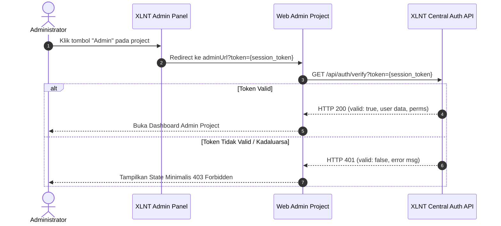

# Panduan Integrasi Admin SSO & Standar Layout Antarmuka (XLNT Ecosystem)

Dokumen ini merupakan panduan standar untuk mengimplementasikan fitur autentikasi admin pada sub-project di ekosistem XLNT (misal: `accnet`, `rodger`, `eldorian`, dll.) agar terintegrasi langsung dengan **XLNT Web Admin Console**, sekaligus menetapkan **standar layout, spacing, hierarki struktur, dan prinsip minimalis** untuk halaman admin, state loading, fallback gambar, dan penanganan error (403/404).

> [!NOTE]
> **Agnostik Warna & Fleksibilitas Tema**:
> **Warna desain TIDAK dipatenkan** dan tidak diwajibkan sama persis. Setiap sub-project bebas menentukan palet warna, tema gelap/terang, aksen brand, serta jenis font sesuai karakteristik produknya masing-masing.
> Yang **dipatenkan dan diwajibkan seragam** adalah **arsitektur layout, proporsi spacing, hierarki elemen, dan prinsip desain minimalisnya (flat, boxy, tanpa AI clutter/dekorasi berlebih)**.

---

## 1. Alur Kerja (Workflow SSO)



---

## 2. Spesifikasi Endpoint Verifikasi

Sub-project memvalidasi token yang masuk dengan memanggil endpoint verifikasi pusat:

* **URL:** `https://xlnt.alwaysdata.net/api/auth/verify`
* **Method:** `GET`
* **Parameter Pengiriman Token (Pilih salah satu):**
  * **Query Parameter:** `?token=<TOKEN>`
  * **Header:** `X-Admin-Token: <TOKEN>`
  * **Header:** `Authorization: Bearer <TOKEN>`

### Respon Sukses (`HTTP 200 OK`)
```json
{
  "valid": true,
  "userId": "123456789012345678",
  "username": "admin_username",
  "expiresAt": 1732353600000,
  "permissions": {
    "panel_access": true,
    "manage_users": true,
    "isDiscordAdmin": true
  }
}
```

### Respon Gagal (`HTTP 401 Unauthorized`)
```json
{
  "valid": false,
  "error": "Session token tidak valid atau telah kadaluarsa"
}
```

---

## 3. Standar Layout, Spacing & Struktur Antarmuka

Semua sub-project menerapkan struktur layout yang bersih, efisien, dan utilitarian:

### A. Prinsip Boxy, Flat & Spacing Bersih
1. **Bebas AI Clutter**: Tidak menggunakan bayangan neon tebal (*glow*), border berpendar, kartu alert bertingkat-tingkat, atau gradien mencolok.
2. **Subtle Corner Radii**: Gunakan sudut kotak rapi yang subtle (`3px - 6px`). Hindari bentuk kapsul bulat berlebihan (*extreme pill 24px+*) pada kontainer data.
3. **Penyelarasan Spacing**: Elemen navigasi atas selalu compact (`56px - 60px`), dan jarak antar grup form/data konsisten (`gap: 16px - 24px`).
4. **Variabel CSS**: Terapkan tema melalui CSS variables agar sub-project dapat mengganti skema warna dengan mudah tanpa mengacak layout:

```css
/* Contoh variabel struktural & tema lokal sub-project */
:root {
    /* Skema warna bebas disesuaikan sub-project masing-masing */
    --bg-page: #121417;        
    --bg-card: #1a1d22;        
    --bg-input: #0e0f12;       
    --bg-nav: #16181d;         
    --border: #282c34;         
    --border-strong: #3b414d;  
    --text-main: #f3f4f6;      
    --text-muted: #6b7280;     

    /* Standar Spacing & Radii (Wajib Konsisten) */
    --topbar-height: 60px;
    --radius-sm: 3px;
    --radius-md: 4px;
}

/* Reset bayangan dekoratif berlebih */
*, *::before, *::after {
    box-sizing: border-box;
    box-shadow: none !important;
    text-shadow: none !important;
}
```

---

### B. Standar Layout Halaman Error (403 Forbidden & 404 Not Found)

Halaman penolakan akses atau halaman tidak ditemukan diatur secara **ultra-minimalis, terpusat, dan bebas gangguan**:

* **Layout Container**: Memenuhi tinggi layar vertikal (`min-height: calc(100vh - var(--topbar-height, 60px))` atau `100vh`), layout flex kolom terpusat di tengah layar (*centered alignment*).
* **Ukuran & Spacing Angka (`.error-code`)**: Angka besar mencolok (`font-size: 72px`), `line-height: 1`, `letter-spacing: -0.04em`, bobot tebal (`font-weight: 800`).
* **Ukuran & Spacing Teks Label (`.error-label`)**: Jarak atas `margin-top: 8px`, `font-size: 14px - 15px`, `font-weight: 600`, format uppercase dengan spasi huruf renggang (`letter-spacing: 0.08em`).
* **Tanpa Elemen Tambahan**: Tidak memerlukan kotak dialog merah menyala, ikon gembok raksasa, atau paragraf peringatan panjang.

```html
<!-- Struktur HTML Standar 403 Forbidden -->
<main class="error-content">
    <div class="error-code">403</div>
    <div class="error-label">Forbidden</div>
</main>
```

```css
/* Layout & Spacing Error Content (Warna Mengikuti Tema Lokal) */
.error-content {
    min-height: calc(100vh - var(--topbar-height, 60px));
    display: flex;
    flex-direction: column;
    align-items: center;
    justify-content: center;
    text-align: center;
    user-select: none;
    padding: 24px;
}

.error-code {
    font-size: 72px;
    font-weight: 800;
    line-height: 1;
    letter-spacing: -0.04em;
    color: var(--text-main, currentColor);
}

.error-label {
    margin-top: 8px;
    font-size: 15px;
    font-weight: 600;
    text-transform: uppercase;
    letter-spacing: 0.08em;
    color: var(--text-muted, #888);
}
```

---

### C. Standar Layout Loading State (Verifikasi Sesi)

State verifikasi token tidak menggunakan modal dialog popup bertingkat atau pesan teks berkedip. Cukup tampilkan indikator spinner terpusat:

* **Layout Container**: Mengisi ruang layar (`min-height: calc(100vh - var(--topbar-height, 60px))`), flexbox `center/center`.
* **Ukuran Spinner**: Berdimensi compact (`width: 24px; height: 24px`), ketebalan garis `2px - 2.5px`.
* **Warna Spinner**: Menggunakan warna teks utama lokal atau `currentColor` dengan track dasar transparan.

```html
<div id="loadingScreen" class="admin-loading-screen">
    <div class="admin-spinner"></div>
</div>
```

```css
.admin-loading-screen {
    min-height: calc(100vh - var(--topbar-height, 60px));
    display: flex;
    align-items: center;
    justify-content: center;
    padding: 24px;
}

.admin-spinner {
    width: 24px;
    height: 24px;
    border: 2.5px solid rgba(127, 127, 127, 0.15);
    border-top-color: var(--text-main, currentColor);
    border-radius: 50%;
    animation: admin-spin 0.75s linear infinite;
}

@keyframes admin-spin {
    to { transform: rotate(360deg); }
}
```

---

### D. Standar Layout Image Fallback (Gambar Rusak / Kosong)

Jika gambar game, avatar pengguna, atau aset gagal dimuat, jangan biarkan browser menampilkan broken image outline atau teks alt yang berantakan. Gunakan wadah fallback dengan ikon vektor netral:

* **Dimensi**: Memenuhi 100% ukuran parent box atau thumbnail yang bersangkutan.
* **Layout**: `display: flex; align-items: center; justify-content: center;`.
* **Border & Corner**: Border tipis (`1px solid var(--border)`) dengan corner radius seragam (`var(--radius-sm, 3px)`).
* **Ikon**: Ikon *slashed image* berukuran proporsional (16px–32px tergantung container), warna redup/sekunder (`opacity: 0.4 - 0.6`).

```html
<div class="img-fallback-box" role="img" aria-label="Image unavailable" title="Image unavailable">
    <svg class="img-fallback-svg" width="24" height="24" viewBox="0 0 24 24" fill="none" stroke="currentColor" stroke-width="2" stroke-linecap="round" stroke-linejoin="round" aria-hidden="true">
        <line x1="2" y1="2" x2="22" y2="22" />
        <path d="M10.41 10.41a2 2 0 1 1-2.83-2.83" />
        <line x1="13.5" y1="13.5" x2="6" y2="21" />
        <line x1="18" y1="12" x2="21" y2="15" />
        <path d="M3.59 3.59A1.99 1.99 0 0 0 3 5v14a2 2 0 0 0 2 2h14c.55 0 1.052-.22 1.41-.59" />
        <path d="M21 15V5a2 2 0 0 0-2-2H9" />
    </svg>
</div>
```

```css
.img-fallback-box {
    width: 100%;
    height: 100%;
    background-color: var(--bg-card, transparent);
    border: 1px solid var(--border, rgba(127, 127, 127, 0.2));
    border-radius: var(--radius-sm, 3px);
    display: flex;
    align-items: center;
    justify-content: center;
}

.img-fallback-svg {
    color: var(--text-muted, currentColor);
    opacity: 0.5;
}
```

---

### E. Standar Layout Topbar Header
* **Tinggi**: `56px - 60px` sticky di posisi atas (`position: sticky; top: 0; z-index: 100;`).
* **Distribusi**: `display: flex; align-items: center; justify-content: space-between;`.
* **Sisi Kiri**: Brand/Wordmark logo project + pembatas `/` + label `Admin`.
* **Sisi Kanan**: Tombol aksi navigasi balik atau tombol Logout (`display: inline-flex; align-items: center; gap: 8px;`).

---

## 4. Contoh Implementasi Teknis

### A. Pada Backend (Express / Node.js)

Gunakan middleware untuk memverifikasi token dan sajikan file statis `403.html` minimalis jika verifikasi gagal:

```javascript
const express = require('express');
const axios = require('axios');
const path = require('path');
const app = express();

async function requireXlntAdmin(req, res, next) {
    const token = req.query.token || req.cookies?.project_admin_token || req.headers['x-admin-token'];

    if (!token) {
        return res.status(403).sendFile(path.join(__dirname, 'public', '403.html'));
    }

    try {
        const response = await axios.get('https://xlnt.alwaysdata.net/api/auth/verify', {
            params: { token },
            timeout: 5000
        });

        if (response.data && response.data.valid && response.data.permissions?.panel_access === true) {
            req.adminUser = response.data;
            res.cookie('project_admin_token', token, {
                httpOnly: true,
                sameSite: 'lax',
                maxAge: Math.max(0, response.data.expiresAt - Date.now())
            });
            return next();
        }
    } catch (err) {
        // Token tidak valid atau server autentikasi tidak merespon
    }

    return res.status(403).sendFile(path.join(__dirname, 'public', '403.html'));
}

// Pasang middleware pada rute admin
app.use('/admin', requireXlntAdmin);
app.get('/admin', (req, res) => {
    res.sendFile(path.join(__dirname, 'public', 'admin.html'));
});
```

---

### B. Pada Frontend Statis (Single Page Application / Static HTML)

Pola transisi state minimalis dari memverifikasi hingga menampilkan dashboard atau 403 Forbidden:

```html
<!DOCTYPE html>
<html lang="en">
<head>
    <meta charset="UTF-8">
    <meta name="viewport" content="width=device-width, initial-scale=1.0">
    <title>Admin</title>
    <!-- Style lokal masing-masing sub-project -->
    <link rel="stylesheet" href="/style.css">
</head>
<body class="admin-page-wrapper">

    <!-- Topbar Standar -->
    <header class="rbx-topbar">
        <div class="topbar-content">
            <a href="/" class="topbar-brand" aria-label="Brand">
                <span class="brand-title">PROJECT_NAME</span>
                <span class="topbar-divider">/</span>
                <span class="topbar-subtitle">Admin</span>
            </a>
            <div class="topbar-actions" id="topbarActions" style="display: none;">
                <button type="button" class="admin-logout-btn" id="btnLogout">Logout</button>
            </div>
        </div>
    </header>

    <!-- State 1: Verifikasi Akses -->
    <div id="loadingScreen" class="admin-loading-screen">
        <div class="admin-spinner"></div>
    </div>

    <!-- State 2: 403 Forbidden Minimalis -->
    <main id="forbiddenScreen" class="error-content" style="display: none;">
        <div class="error-code">403</div>
        <div class="error-label">Forbidden</div>
    </main>

    <!-- State 3: Admin Dashboard Aktif -->
    <main id="adminDashboard" class="admin-dashboard-container" style="display: none;">
        <h1 id="welcomeUser">Admin Panel</h1>
        <!-- Konten Dashboard Sub-project -->
    </main>

    <script>
        async function initAdminAuth() {
            const urlParams = new URLSearchParams(window.location.search);
            const tokenFromUrl = urlParams.get('token');
            const token = tokenFromUrl || sessionStorage.getItem('xlnt_admin_token');

            if (!token) {
                showForbidden();
                return;
            }

            try {
                const res = await fetch(`https://xlnt.alwaysdata.net/api/auth/verify?token=${encodeURIComponent(token)}`);
                const data = await res.json().catch(() => null);

                if (res.ok && data && data.valid && data.permissions?.panel_access === true) {
                    sessionStorage.setItem('xlnt_admin_token', token);
                    sessionStorage.setItem('xlnt_admin_user', JSON.stringify(data));

                    // Bersihkan ?token= dari URL browser demi keamanan
                    if (tokenFromUrl) {
                        const cleanUrl = window.location.pathname;
                        window.history.replaceState({}, document.title, cleanUrl);
                    }

                    showDashboard(data);
                    return;
                }
            } catch (err) {
                console.error("Auth check failed:", err);
            }

            sessionStorage.removeItem('xlnt_admin_token');
            sessionStorage.removeItem('xlnt_admin_user');
            showForbidden();
        }

        function showForbidden() {
            document.getElementById('loadingScreen').style.display = 'none';
            document.getElementById('adminDashboard').style.display = 'none';
            document.getElementById('topbarActions').style.display = 'none';
            document.getElementById('forbiddenScreen').style.display = 'flex';
        }

        function showDashboard(userData) {
            document.getElementById('loadingScreen').style.display = 'none';
            document.getElementById('forbiddenScreen').style.display = 'none';
            document.getElementById('topbarActions').style.display = 'inline-flex';
            document.getElementById('adminDashboard').style.display = 'block';

            const userTitle = document.getElementById('welcomeUser');
            if (userTitle) userTitle.textContent = `Welcome, ${userData.username}`;
        }

        document.getElementById('btnLogout')?.addEventListener('click', () => {
            sessionStorage.removeItem('xlnt_admin_token');
            sessionStorage.removeItem('xlnt_admin_user');
            window.location.href = '/';
        });

        initAdminAuth();
    </script>
</body>
</html>
```

---

## 5. Standar Keamanan & Praktik Terbaik

1. **Pembersihan URL (`History ReplaceState`)**:
   Segera bersihkan query parameter `?token=...` dari address bar browser setelah token disimpan ke cookie atau `sessionStorage`. Hal ini mencegah token bocor melalui referer header atau riwayat browser.
2. **Patuhi Batas Waktu (`expiresAt`)**:
   Gunakan properti `expiresAt` (Unix timestamp dalam milidetik) dari respon verifikasi untuk mengatur batas waktu cookie atau pembersihan sesi lokal secara otomatis.
3. **Pengecekan Izin Akses Panel (`permissions.panel_access`)**:
   Pastikan properti `data.permissions.panel_access === true` sebelum mengizinkan aksi administratif apapun.
4. **CORS & Domain Whitelist**:
   Server pusat XLNT telah mengaktifkan CORS untuk seluruh subdomain `*.xlnt.my.id`, sehingga pemanggilan verifikasi dari sisi browser dapat berjalan langsung tanpa kendala CORS.
5. **Fokus pada Utilitarian & Flat**:
   Meskipun warna bebas disesuaikan, pertahankan layout boxy, spacing proporsional, dan hilangkan efek AI berlebih (bayangan bergradasi, teks bertumpuk, atau animasi terlalu cepat) agar antarmuka tetap ringan, cepat, dan profesional.
